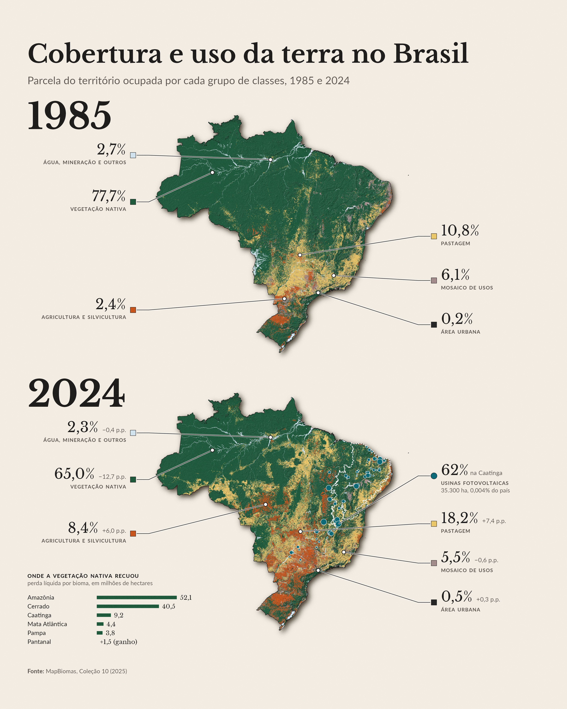

# Cobertura e uso da terra no Brasil

## Summary

An editorial poster (4:5, 300 dpi) that compares land cover and land use in Brazil in 1985 and 2024, from MapBiomas Collection 10. Two stacked maps, shaded by relief and printed on warm paper, show where each of six groups of classes sits; leader-line labels give the share of the country in each year (and, for 2024, the change in percentage points), and the 2024 panel adds where native vegetation retreated, by biome. The result is `viz/brasil_cobertura_1985_2024.png`:

- **Conversion.** Natural areas lost 111.7 million hectares in net terms between 1985 and 2024, 13.1% of the country's 850.7 Mha. Pasture gained 62.7 Mha and agriculture 44.0 Mha.
- **Composition.** Native vegetation fell from 77.7% to 65.0% of the territory, pasture rose from 10.8% to 18.2% and agriculture (with forest plantations) from 2.4% to 8.4%.
- **Solar.** Photovoltaic power plants, a class that only exists in recent years, cover 35,300 ha in 2024; 61.8% of that area is in the Caatinga.



## Method

- **Areas.** Every number on the poster comes from the official Collection 10 statistics (area in hectares per class, biome and state, computed by MapBiomas at 30 m). The maps only draw where each group sits.
- **Groups.** The 30 classes become six groups plus solar: native vegetation, pasture, agriculture and forest plantation, mosaic of uses, urban area, photovoltaic power plants and other (water, aquaculture, beaches and dunes, mining, other non-vegetated and not observed). `data/processed/class_groups.csv` lists every class with its group and MapBiomas' own Natural/Antropic flag.
- **Natural areas.** The 111.7 Mha figure is the net loss of the classes MapBiomas flags as Natural at level 0: native vegetation plus natural water bodies and beaches, dunes and sand spots. Native vegetation alone lost 108.4 Mha; the difference is mostly water, which shrank by about 3 Mha, much of it in the Pantanal, where native vegetation grew by 1.5 Mha.
- **Maps.** The 30 m annual maps are reduced in Earth Engine (`gee/download_coverage_col10.py`): classes are grouped first, then each cell of 34 × 34 source pixels (about 1 km) takes the most frequent group, weighted by pixel overlap. A second band counts the 30 m photovoltaic pixels in each cell, so small plants survive the reduction; the poster sums them in 25 km cells. Summed this way they cover 37,400 ha against the official 35,300 ha (cells at tile and block edges overlap partially), so this figure only sets the marker size. The maps are projected to an Albers equal-area conic (nearest neighbour). The same reduction can run locally on the official 30 m GeoTIFFs when they are available.
- **Relief.** SRTM elevation (CGIAR SRTM 90 m v4) is averaged on the same 1 km grid in Earth Engine (`--dem`), exaggerated 15 times and lit from the north-west; shaded slopes darken each colour and lit slopes mix it towards white. It is texture only and carries no data.
- **Validation.** `data/processed/validation.csv` compares the computed figures with the published ones and reports, for each group, the share kept by the 1 km majority map against the official 30 m share. Majority resampling enlarges dominant groups and shrinks scattered ones (urban area, mosaic, small crops), which is why no number is read from the maps.

## Structure

- `R/land_cover_1985_2024.R`: the whole workflow, with configurable paths at the top: download of the statistics, class mapping, areas, validation, reduction or mosaicking of the maps and the poster (ggplot2, patchwork, ggtext, ggfx, magick, terra, sf, geobr).
- `gee/download_coverage_col10.py`: reduced Collection 10 maps fetched from Earth Engine in tiles, no Google Drive needed.
- `gee/export_coverage_col10.js`: the same reduction as an Earth Engine Code Editor script that exports to Google Drive.
- `data/raw/mapbiomas/`: statistics workbook and map tiles, not versioned.
- `data/processed/`: tables and reduced maps used by the poster.
- `assets/fonts/`: Libre Baskerville and Lato, with their OFL licences.
- `viz/`: final poster.

## Running

The 30 m GeoTIFFs in the public MapBiomas bucket refuse anonymous and authenticated downloads (HTTP 403), so the maps come from the public Earth Engine asset `projects/mapbiomas-public/assets/brazil/lulc/v1` (Collection 10). That needs a Google Cloud project registered for noncommercial Earth Engine use.

```bash
Rscript -e 'install.packages(c("dplyr", "geobr", "ggfx", "ggplot2", "ggtext", "magick", "patchwork", "purrr", "ragg", "readr", "readxl", "scales", "sf", "stringr", "systemfonts", "terra", "tidyr"))'
python -m pip install earthengine-api
gcloud auth application-default login --scopes=https://www.googleapis.com/auth/earthengine,https://www.googleapis.com/auth/cloud-platform
python gee/download_coverage_col10.py --project <cloud-project-id> --dem
Rscript R/land_cover_1985_2024.R
```

The download makes 1,020 requests (340 tiles for each year and for the elevation) and takes about 40 minutes; tiles already on disk are skipped.

## Outputs

| file in `data/processed/` | content |
| ------------------------- | ------- |
| `class_groups.csv`        | the 30 MapBiomas classes with their group and level-0 flag |
| `group_areas_brazil.csv`  | area and share of the country per group, 1985 and 2024 |
| `biome_areas.csv`         | native, natural and photovoltaic area per biome and year |
| `headline.csv`            | net loss of natural areas, country area and solar figures |
| `validation.csv`          | computed figures against published ones, and the resampling check |
| `map_groups_<year>.tif`   | 1 km majority group and photovoltaic pixel count |
| `dem_srtm_1km.tif`        | mean SRTM elevation on the same grid, for the hillshade |

## References

- Projeto MapBiomas. [Coleção 10 da Série Anual de Mapas de Cobertura e Uso da Terra do Brasil](https://brasil.mapbiomas.org/colecoes-mapbiomas/), accessed November 2026.
- MapBiomas (2025). [Destaques do mapeamento anual de cobertura e uso da terra, Coleção 10](https://brasil.mapbiomas.org/wp-content/uploads/sites/4/2025/08/Fact_Colecao10_22.08.2025_v9.pdf).
- Souza, C. M. et al. (2020). [Reconstructing three decades of land use and land cover changes in Brazilian biomes with Landsat archive and Earth Engine](https://doi.org/10.3390/rs12172735). Remote Sensing 12(17).
